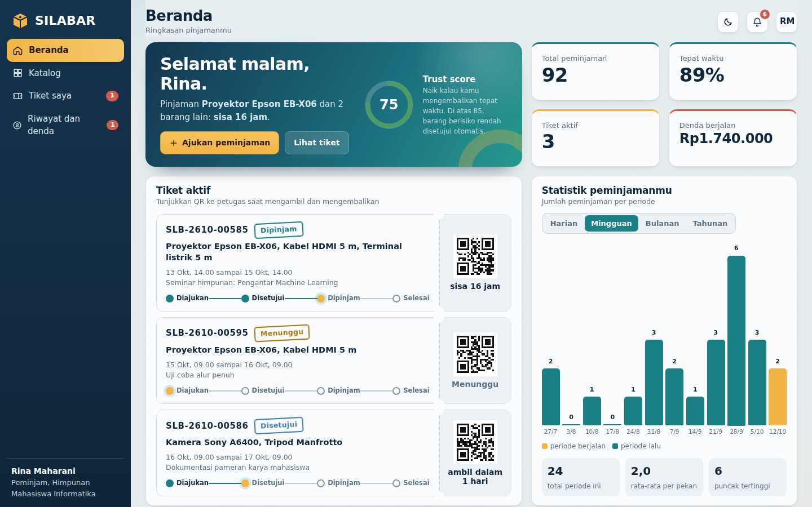
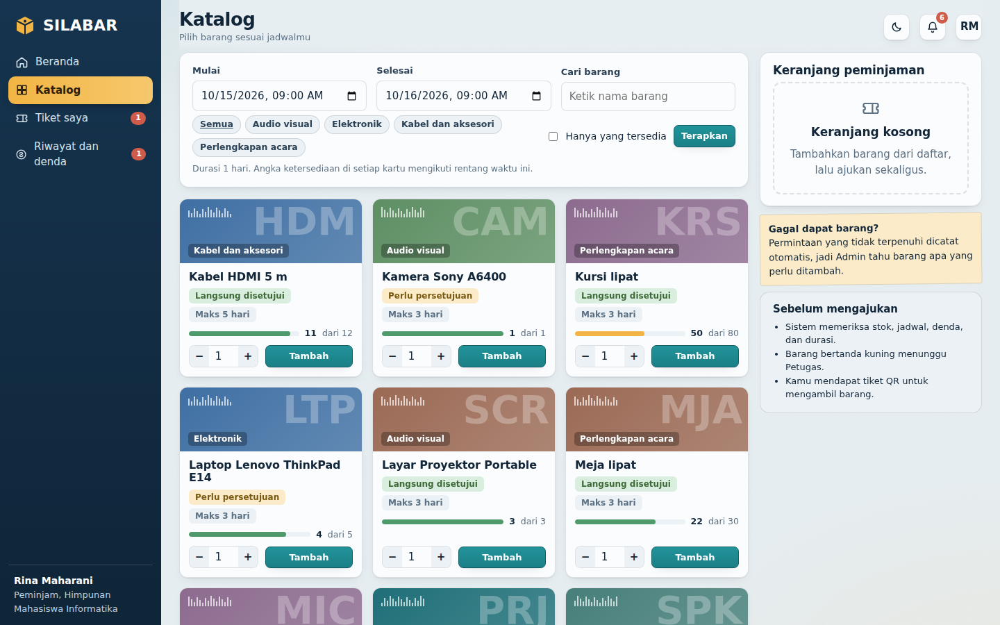
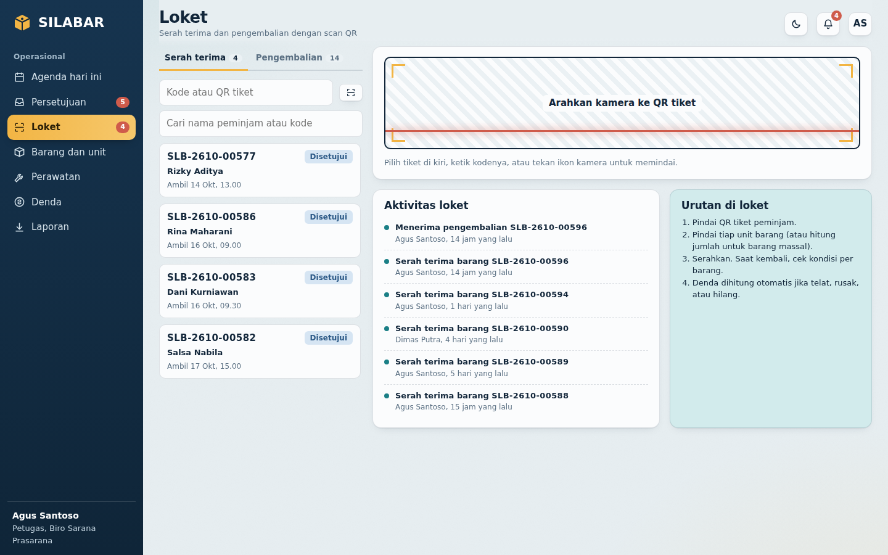
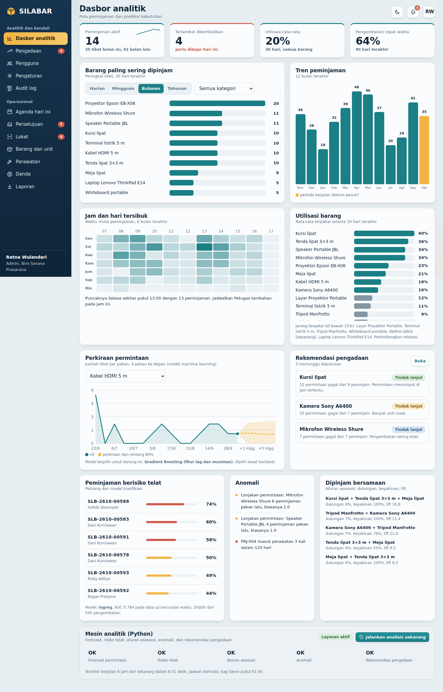

# SILABAR

Sistem Informasi Pelayanan dan Manajemen Peminjaman Barang Inventaris Kampus berbasis web dengan Laravel.

Aplikasi ini dirancang untuk mendigitalkan proses peminjaman barang, mulai dari pengecekan ketersediaan stok, pengajuan pinjaman, pengambilan dengan tiket QR, hingga serah terima dan pengembalian unit.

---

## 📷 Preview

| Beranda Peminjam | Katalog Barang |
| :---: | :---: |
|  |  |

| Loket Petugas | Dasbor Analitik |
| :---: | :---: |
|  |  |

---

## 🚀 Fitur Utama

- **Peminjam (Mahasiswa / Tendik):**
  - Cek ketersediaan stok & jadwal barang secara realtime.
  - Pengajuan peminjaman barang tunggal maupun multi-barang (keranjang).
  - Tiket peminjaman berbasis QR Code untuk verifikasi loket.
  - Riwayat peminjaman, perpanjangan, serta cetak bukti / berita acara.

- **Petugas:**
  - Validasi dan verifikasi tiket QR saat serah terima maupun pengembalian.
  - Manajemen kondisi fisik barang/unit (bagus, rusak, hilang) dan pencatatan denda otomatis.
  - Manajemen perawatan barang dan laporan rekap transaksi harian.

- **Admin:**
  - Manajemen master data (barang, kategori, unit fisik, lokasi).
  - Manajemen pengguna dan hak akses (Role-Based Access Control).
  - Dasbor metrik, riwayat audit log, serta pengaturan ambang durasi pinjam.

---

## 💻 Tech Stack

- **Framework:** Laravel 11/12 (PHP 8.2+)
- **Frontend:** Blade Templating, Custom CSS & JavaScript
- **Database:** SQLite (default/development) / MySQL / PostgreSQL
- **Tools:** Composer, Docker

---

## ⚙️ Panduan Instalasi Lokal

### 1. Clone Repository
```bash
git clone https://github.com/faviandisini89/silabar.git
cd silabar
```

### 2. Install Dependencies
```bash
composer install
```

### 3. Environment & Database
Salin file `.env` dan generate application key:
```bash
cp .env.example .env
php artisan key:generate
```

Buat file database SQLite (jika menggunakan SQLite) dan jalankan migrasi beserta data seeder:
```bash
# Untuk Linux / Mac
touch database/database.sqlite

# Untuk Windows (PowerShell)
New-Item -ItemType File -Path database/database.sqlite -Force

# Jalankan migrasi & data demo
php artisan migrate --seed
```

### 4. Jalankan Aplikasi
```bash
php artisan serve
```
Buka browser di `http://127.0.0.1:8000`.

---

## 🔑 Akun Demo (Development)

Password default untuk semua akun: **`silabar123`**

| Peran | Email |
| :--- | :--- |
| **Admin** | `admin@silabar.id` |
| **Petugas** | `agus@silabar.id` |
| **Peminjam** | `rina@mhs.silabar.id` |
