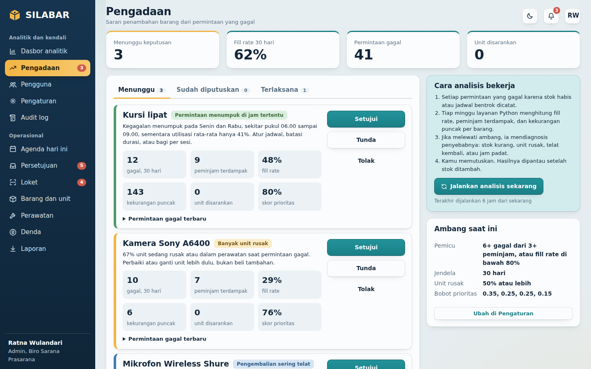

# SILABAR — Sistem Inventaris dan Pelayanan Peminjaman Barang

Aplikasi web peminjaman barang kampus: **Laravel** untuk seluruh alur transaksi, **Python (FastAPI + scikit-learn)** untuk analisis machine learning. Tiga peran: **Peminjam**, **Petugas**, dan **Admin**.


| | |
|---|---|
| Backend | Laravel 12 (PHP 8.2+), Blade, tanpa paket tambahan selain bawaan Laravel |
| Database | SQLite untuk pengembangan, MySQL 8 atau PostgreSQL untuk produksi |
| Analitik | Python 3.10+: pandas, scikit-learn, SQLAlchemy, FastAPI |
| Tampilan | CSS tulis tangan (`public/css/silabar.css`), grafik dirender di server (SVG), tema terang dan gelap |
| QR | `qrcode-generator` (menggambar) dan `html5-qrcode` (memindai lewat kamera), keduanya dari CDN |

## Isi

1. [Apa yang sudah ada](#apa-yang-sudah-ada)
2. [Instalasi](#instalasi)
3. [Menjalankan](#menjalankan)
4. [Cara kerja analitik dan machine learning](#cara-kerja-analitik-dan-machine-learning)
5. [Alur peminjaman dan aturan bisnis](#alur-peminjaman-dan-aturan-bisnis)
6. [Struktur proyek](#struktur-proyek)
7. [Pengujian dan apa yang sudah diverifikasi](#pengujian-dan-apa-yang-sudah-diverifikasi)
8. [Konfigurasi dan produksi](#konfigurasi-dan-produksi)
9. [Yang belum ada](#yang-belum-ada)

## Apa yang sudah ada

**Peminjam:** katalog dengan ketersediaan per jadwal dan kalender per barang, keranjang multi-barang, pemeriksaan otomatis (stok, jadwal bentrok, denda tertunggak, batas durasi) dengan tanggal alternatif, tiket QR dengan status berjenjang, pembatalan, permintaan perpanjangan, riwayat dan denda, berita acara (cetak atau simpan PDF dari browser), notifikasi, serta dasbor statistik pribadi (harian, mingguan, bulanan, tahunan).

**Petugas:** agenda hari ini, persetujuan dengan trust score dan skor risiko telat, loket serah terima dan pengembalian dengan scan QR (kamera atau ketik kode), kondisi per unit dan denda otomatis, pengembalian sebagian untuk barang massal, barang dan unit dengan label QR, perawatan, denda, laporan harian, ekspor CSV.

**Admin** (mewarisi semua hak Petugas): dasbor analitik (top barang per periode, tren, heatmap, utilisasi, perkiraan permintaan, risiko telat, anomali, aturan asosiasi), rekomendasi pengadaan dengan diagnosis penyebab, pengguna dan peran, pengaturan aturan dan ambang, audit log, impor barang dari CSV.

| Layar | Cuplikan |
|---|---|
| Dasbor analitik |  |
| Rekomendasi pengadaan |  |
| Loket Petugas |  |
| Katalog |  |

Palet "Samudra": biru-navy untuk teks dan sidebar, teal laguna sebagai warna utama, satu aksen kuning-amber yang hanya dipakai untuk menandai yang aktif. Mode gelap mengikuti pengaturan perangkat atau tombol di pojok kanan atas.

## Instalasi

Butuh: **PHP 8.2+** (ekstensi `pdo_sqlite`, `mbstring`, `xml`, `curl`), **Composer**, **Python 3.10+**.

```bash
unzip silabar-laravel-python.zip && cd silabar
./setup.sh
```

`setup.sh` membuat kerangka Laravel di sekeliling berkas SILABAR (tanpa menimpa berkas SILABAR), mendaftarkan service provider, menyiapkan `.env`, menjalankan migrasi dan seeder data demo (sekitar 20 detik), lalu memasang layanan Python ke `analytics/.venv`.

**Windows tanpa WSL:** jalankan langkahnya manual di PowerShell.

```powershell
composer create-project laravel/laravel .silabar-skeleton
robocopy .silabar-skeleton . /E /XC /XN /XO     # tidak menimpa berkas yang sudah ada
rmdir /S /Q .silabar-skeleton
del tests\Feature\ExampleTest.php, tests\Unit\ExampleTest.php
composer install
# tambahkan baris  App\Providers\SilabarServiceProvider::class,  ke bootstrap/providers.php
copy .env.example .env ; type env.additions >> .env
php artisan key:generate
type nul > database\database.sqlite
php artisan migrate:fresh --seed
python -m venv analytics\.venv ; analytics\.venv\Scripts\pip install -r analytics\requirements.txt
```

## Menjalankan

Tiga proses, masing-masing di terminal sendiri:

```bash
php artisan serve                 # aplikasi: http://127.0.0.1:8000
php artisan schedule:work         # pewaktu: terlambat, pengingat H-1, statistik harian, analisis mingguan

cd analytics
TZ=Asia/Jakarta \
DATABASE_URL=sqlite:///$(cd .. && pwd)/database/database.sqlite \
ANALYTICS_TOKEN=ganti-dengan-token-rahasia \
.venv/bin/uvicorn silabar_analytics.api:app --port 8001
```

Setelah layanan Python menyala, jalankan analisis pertama: `php artisan analytics:run` (atau tombol **Jalankan analisis sekarang** di dasbor Admin). Seeder otomatis menjalankannya bila layanan sudah menyala saat seeding.  

Akun demo (kata sandi `silabar123`, hanya muncul di `APP_ENV=local`):

| Peran | Email |
|---|---|
| Peminjam | `rina@mhs.silabar.id` |
| Petugas | `agus@silabar.id` |
| Admin | `admin@silabar.id` |

Dengan Docker, layanan Python bisa dijalankan lewat `docker compose up analytics` (lihat `docker-compose.yml`).

## Cara kerja analitik dan machine learning

Laravel mencatat semua transaksi, termasuk **setiap permintaan yang gagal** (`unmet_demand_logs`) beserta konteks saat gagal: tingkat keterpakaian, bagian unit yang rusak, dan jumlah unit yang telat. Layanan Python hanya **membaca** database lalu **menulis hasil** ke tabel analitik. Dasbor membaca hasil tersimpan itu, jadi halaman cepat dan tetap hidup walau layanan Python mati.

| Analisis | Metode | Ditulis ke |
|---|---|---|
| Perkiraan permintaan 4 pekan | Rata-rata bergerak sebagai pembanding vs. Gradient Boosting dengan fitur lag dan musiman (kuantil 10/50/90 untuk rentang). Model dipilih per barang lewat backtest rolling-origin | `demand_forecasts` |
| Risiko telat per peminjaman | Regresi logistik vs. Gradient Boosting, dipilih lewat AUC pada pemisahan data **berurutan waktu**. Fitur riwayat peminjam dihitung hanya dari data yang sudah ada saat pengajuan (tanpa kebocoran) | `overdue_risk_scores` |
| Barang dipinjam bersamaan | Apriori (dukungan, keyakinan, lift) | `analysis_outputs` |
| Anomali | Isolation Forest dan z-score robust pada permintaan mingguan, ditambah unit yang berulang rusak | `analysis_outputs` |
| Rekomendasi pengadaan | Aturan ambang atas `unmet_demand_logs`, diagnosis penyebab, jumlah tambahan dari persentil ke-90, diperkuat proyeksi forecast | `procurement_recommendations` |

Rincian ada di [`docs/ML.md`](docs/ML.md). Ringkasnya: bila data masih tipis, tiap model **mundur ke metode sederhana** (rata-rata bergerak, aturan heuristik) dan mencatat model apa yang dipakai, sehingga dasbor selalu jujur soal asal angkanya.

## Alur peminjaman dan aturan bisnis

Status: `pending → approved → borrowed → (overdue) → returned`, ditambah `rejected` dan `cancelled`. Transisi dijaga di satu tempat (`app/Enums/LoanStatus.php`), jadi lompatan ilegal mustahil terjadi.

- **Ketersediaan** dihitung dengan menyapu semua pinjaman yang menahan stok pada rentang waktu itu (`app/Domain/Reservations.php`). Pinjaman yang berurutan tidak saling menghalangi.
- **Persetujuan:** barang bertanda *perlu persetujuan* menunggu Petugas, kecuali peminjam punya trust score di atas ambang (bisa dimatikan di Pengaturan).
- **Serah terima** wajib memindai tiap unit. Sistem memastikan unit sesuai barang dan sedang tersedia. Setiap unit fisik mendapat satu baris `loan_details`.
- **Pengembalian** mencatat kondisi per barang. Terlambat, rusak, dan hilang menghasilkan denda otomatis. Unit rusak otomatis masuk perawatan dan keluar dari stok tersedia.
- **Jam otomatis** (`loans:tick`, tiap menit): menandai terlambat, mengirim pengingat H-1, membatalkan tiket yang tidak diambil setelah masa tenggang.
- **Rekomendasi pengadaan** hanya dibuat bila permintaan gagal melewati ambang (default: 5 gagal dari 3 peminjam berbeda dalam 30 hari, atau fill rate di bawah 80%). Sistem membedakan *stok kurang*, *banyak unit rusak*, *pengembalian sering telat*, dan *permintaan menumpuk di jam tertentu*: tidak semua kehabisan berarti harus membeli.

## Struktur proyek

```
app/Enums, app/Domain     aturan bisnis murni (tanpa framework, diuji tersendiri)
app/Services              ketersediaan, validasi, peminjaman, statistik, klien analitik
app/Http/Controllers      Borrower/, Staff/, Admin/
app/Console/Commands      loans:tick, stats:aggregate, analytics:run
database/migrations       20 tabel aplikasi (di luar tabel bawaan Laravel)
database/seeders          BaseSeeder (data dasar) dan DemoDataSeeder (18 bulan riwayat)
resources/views           Blade: layouts, borrower, staff, admin
public/css, public/js     gaya dan skrip front-end
analytics/                layanan Python (FastAPI) beserta tes
tools/                    selftest.php dan check_schema.py
docs/                     ML.md dan cuplikan layar
```

## Pengujian dan apa yang sudah diverifikasi

```bash
php artisan test                         # 27 tes: aturan bisnis, siklus pinjaman, akses peran
php tools/selftest.php                   # 38 pemeriksaan aturan bisnis tanpa framework
cd analytics && pip install -r requirements-dev.txt && pytest     # 17 tes layanan Python
python3 tools/check_schema.py            # kolom yang dipakai Python selalu ada di migrasi
```

Semuanya dijalankan pada kode final ini di lingkungan **PHP 8.3, Laravel 12.70, SQLite, Python 3.12, scikit-learn 1.8**, dan lulus. Selain itu diuji:

- seeder penuh (±600 pinjaman, 18 bulan) berjalan sampai selesai;
- alur ujung ke ujung lewat browser sungguhan (Playwright): pengajuan valid dan gagal, persetujuan, serah terima dengan unit, pengembalian rusak dengan denda, keputusan dan pencatatan pengadaan, simpan pengaturan (25 pemeriksaan, tanpa galat JavaScript);
- 57 halaman dibuka untuk tiap peran terhadap data berisi hasil analisis;
- 28 template Blade dikompilasi dengan kompiler Blade asli Laravel;
- Laravel memanggil layanan Python lewat HTTP dan hasilnya tampil di dasbor.

**Belum diuji:** MySQL dan PostgreSQL (migrasi memakai tipe standar Laravel dan SQL Python memakai SQLAlchemy, tetapi belum dijalankan di sana), pemindaian dengan kamera sungguhan (jalur ketik kode sudah diuji), dan pengiriman email.

## Konfigurasi dan produksi

- Salin `.env.example`, set `APP_ENV=production`, `APP_DEBUG=false`, database MySQL/PostgreSQL, dan **ganti `ANALYTICS_TOKEN`** (nilai yang sama di `.env` Laravel dan di layanan Python).
- Jangan jalankan `DemoDataSeeder` di produksi: `php artisan db:seed --class=BaseSeeder`. Ganti kata sandi akun Admin awal.
- Pewaktu: cron `* * * * * php /path/artisan schedule:run`. Layanan Python berjalan sebagai service terpisah (systemd atau Docker) dengan `TZ` yang sama dengan `APP_TIMEZONE`.
- Email: set `MAIL_MAILER` dan `SILABAR_MAIL_NOTIFICATIONS=true`. Notifikasi di dalam aplikasi selalu aktif.
- Semua ambang bisnis (durasi, tarif denda, ambang rekomendasi, bobot prioritas) bisa diubah Admin di **Pengaturan** tanpa menyentuh kode. Layanan Python membaca nilai yang sama dari tabel `settings`.

## Yang belum ada

- **Notifikasi WhatsApp** (V2 di spesifikasi): butuh keputusan penyedia gateway. Titik pasangnya `app/Notifications/GenericNotification.php` (tambahkan channel di `via()`).
- **Stock opname via QR** (V3).
- **Impor dan ekspor Excel (.xlsx):** yang tersedia CSV, yang bisa dibuka langsung di Excel dan Google Sheets.
- **Berita acara PDF:** berupa halaman siap cetak, simpan sebagai PDF dari dialog cetak browser.
- Tarif denda, batas durasi, dan rumus trust score memakai nilai awal yang masuk akal (lihat Pengaturan). Sesuaikan dengan kebijakan kampusmu.
